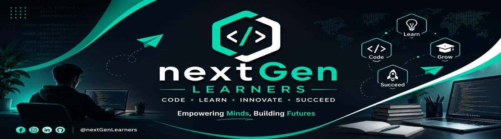

  

<h1 align="center">NextGen Learners — Data Science Internship</h1>

  My weekly deliverables, notebooks, and datasets from the <b>NextGen Learners</b> Data Science Internship.

---

##  About

This repository documents my progress through the **NextGen Learners Data Science Internship**. Each week focuses on a practical, real-world task, and every folder contains the full work: a documented notebook, the data, and a short write-up of the decisions I made and why.

> **Philosophy:** clean code is good, but *explained decisions* are better. Every notebook mixes code with markdown reasoning so anyone can follow the thinking, not just the output.

---

## 🗂️ Weekly Progress

| Week | Topic | Skills | Status |
|:----:|-------|--------|:------:|
| 1 | [Cleaning & Exploring the Applicant Dataset](./NextGenLearners_Week1_Data_Cleaning) | Pandas, data cleaning, wrangling, EDA | ✅ Done |
| 2 | _Coming soon_ | — | ⏳ |
| 3 | _Coming soon_ | — | ⏳ |
| 4 | _Coming soon_ | — | ⏳ |

---

